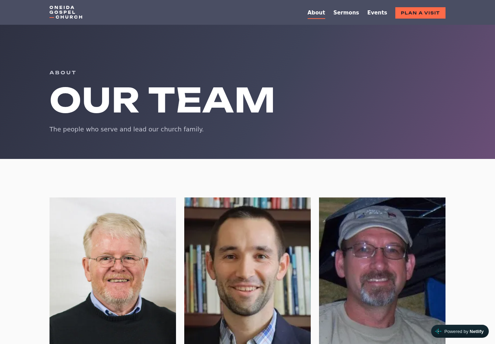
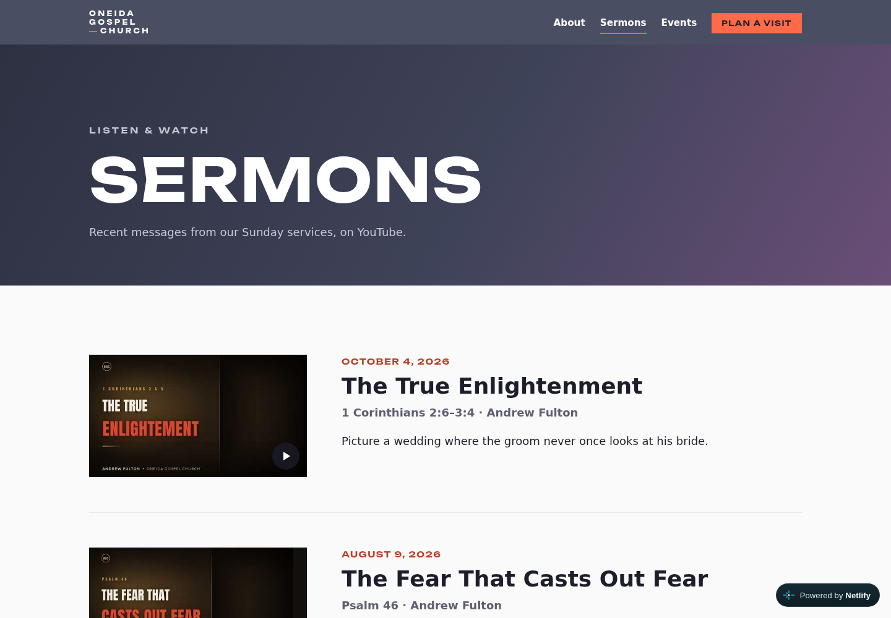
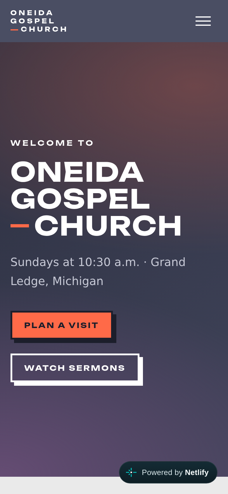

# Oneida Gospel Church website

A prototype replacement for a small church's Wix site: fast, accessible, and
cheap to run, with content volunteers can edit without touching code.

**Live demo:** https://ogc-website.netlify.app (hidden from search engines
until go-live)


| Team | Sermons | Phone |
|---|---|---|
|  |  |  |

- **Astro 7**, static output, plain CSS with design tokens. No client
  framework; the only JavaScript is the mobile menu toggle.
- **Content as files:** Markdown/JSON content collections with a typed schema,
  so a bad entry fails the build and names the file. Adding a team member is
  one Markdown file. Ready for a git-based CMS later.
- **Sermons import themselves:** a GitHub Actions job reads the church's
  YouTube feed twice a day, writes new sermon files, and commits them;
  Netlify deploys.
- **Events stay current:** weekly events compute their next date
  (DST-safe, America/Detroit), and a daily build hook drops past events.
- **Netlify** for hosting, deploy previews on pull requests, and the contact
  form (Netlify Forms, honeypot spam filter).
- Lighthouse accessibility 100 on every page; mobile-first layout.

## About the code

Static site built with [Astro](https://astro.build). All content lives in
plain files under `src/content/` and `src/data/` — no code changes needed to
update people, sermons, events, or service times.

## Run locally

Requires Node 22.23.4+ (`nvm use` picks it up from `.nvmrc`).

```bash
npm install
npm run dev      # http://localhost:4321
npm run build    # type-check + build to dist/
npm test         # unit tests
npm run verify   # tests + type-check + build (the release gate)
```

After cloning, turn on the repo's git settings (commit email set to the
GitHub no-reply address, so personal email stays out of history):

```bash
git config include.path ../.gitconfig
```

## Editing content

| What | Where |
|---|---|
| Team members | `src/content/team/*.md` (one file per person) |
| Sermons | `src/content/sermons/*.md` |
| Events | `src/content/events/*.md` |
| Service times, address, map, social links | `src/data/site.json` |

The build checks every file against the rules in `src/content.config.ts`.
If something is wrong (missing name, short bio too long, bad date), the build
stops and names the file and field.

### Add a team member

1. Create `src/content/team/first-last.md`. The filename becomes the page URL:
   `/team/first-last`.
2. Optional: put their photo next to it, e.g. `src/content/team/first-last.jpg`.
3. Fill in:

```markdown
---
name: First Last            # required
role: Deacon
photo: ./first-last.jpg     # optional; path relative to this file
photoAlt: First Last smiling outside the church   # optional
displayOrder: 5             # lower numbers appear first; omit to sort last
shortBio: A few sentences. The team card shows the first ~150 characters. 400 max.
---

Full bio goes here, in Markdown. It appears on the person's detail page
after they click "Read More".
```

That's it — the person appears on the About page in `displayOrder` order
(ties sort by name) and gets their own detail page.

To keep a URL stable when renaming the file, add `slug: first-last` to the
frontmatter.

### Add a sermon

New uploads to the church YouTube channel are imported automatically: a
GitHub Actions workflow (`.github/workflows/import-sermons.yml`) checks twice a
day (8 a.m. and 6 p.m. Eastern), commits any new sermon files to `main`, and
Netlify deploys them. To run it now: GitHub → Actions → Import sermons →
Run workflow.

To pull uploads by hand instead:

```bash
npm run sermons:import
```

It reads the channel's feed (latest 15 videos), takes the speaker, scripture
and sermon date from the video description's `🎙 Speaker:`, `📖 Scripture:`
and `🗓` lines, and writes one file per new video. Videos already imported are
skipped, so edits you make to those files are kept. Commit the new files.

Or add one by hand, `src/content/sermons/2026-11-01-title.md`:

```markdown
---
title: Sermon Title
date: 2026-11-01
speaker: Speaker Name
passage: Psalm 46          # optional
youtubeUrl: https://www.youtube.com/watch?v=...
series: Series Name        # optional
summary: One-line teaser.  # optional
---
```

### Add an event

`src/content/events/2026-12-24-christmas-eve.md`:

```markdown
---
title: Christmas Eve Service
start: 2026-12-24T18:00:00-05:00
end: 2026-12-24T19:00:00-05:00   # optional
location: Sanctuary              # optional
summary: Short description.      # optional
---
```

Past events drop off automatically; the site rebuilds every morning
(`.github/workflows/daily-rebuild.yml`).

For something that meets every week, give the first meeting's date and add
`repeat: weekly`. The site always shows the next upcoming meeting. Add
`until: 2026-12-16` to stop after a date.

```markdown
---
title: Women's Bible Study
start: 2026-09-16T09:30:00-04:00   # first meeting
repeat: weekly
until: 2026-12-16                  # optional
---
```

## Deploy

The live demo is always the **newest release tag** (`vX.Y.Z`), never
`main`'s latest commit, so work in progress can sit on `main` without going
live. Each push to `main` makes Netlify run `scripts/build-release.sh`,
which builds the newest tag; until you cut a release, it rebuilds the same
version. Every pull request still gets a deploy preview of its own commit
(config in `netlify.toml`). The contact form uses Netlify Forms.

Sermons the import workflow adds to `main` go live with the next release.

### Releasing

Versions follow [Semantic Versioning 2.0.0](https://semver.org/spec/v2.0.0.html).
For this site, the "public API" is the content file format and the page URLs:

| Bump | When |
|---|---|
| MAJOR | Existing content files need edits to keep building, or a page URL is removed or renamed without a redirect |
| MINOR | A new page or feature, or a new optional content field |
| PATCH | Fixes, copy and style tweaks, new sermons or events |

Versions stay at `0.y.z` until the site goes live for real; `1.0.0` is the
public launch.

Only release a version that's done and passes everything:

1. Note your changes under `## [Unreleased]` in `CHANGELOG.md` and commit.
2. Push `main`.
3. Run:

   ```bash
   npm run release -- patch   # or minor, major, or an exact version like 1.0.0
   ```

The script stops unless you're on a clean `main` that matches GitHub, runs
`npm run verify` (unit tests, type check, build), then bumps `package.json`,
turns `Unreleased` into the new version, commits `release: vX.Y.Z`, tags it,
and pushes both. Netlify publishes it. Add `--dry-run` to preview the
version and CHANGELOG without changing anything.

**Roll back:** in Netlify → Project configuration → Environment variables,
set `RELEASE_TAG` to an older tag (e.g. `v0.1.0`) and trigger a deploy.
Delete the variable to return to the newest release. (Netlify's Deploys page
can also re-publish an earlier deploy instantly.)

### Search engines

The demo is hidden from search engines (`noindex` meta tag and a
`Disallow: /` robots.txt). At go-live, set `PUBLIC_ALLOW_INDEXING=true` in the
Netlify site's environment variables and redeploy.
