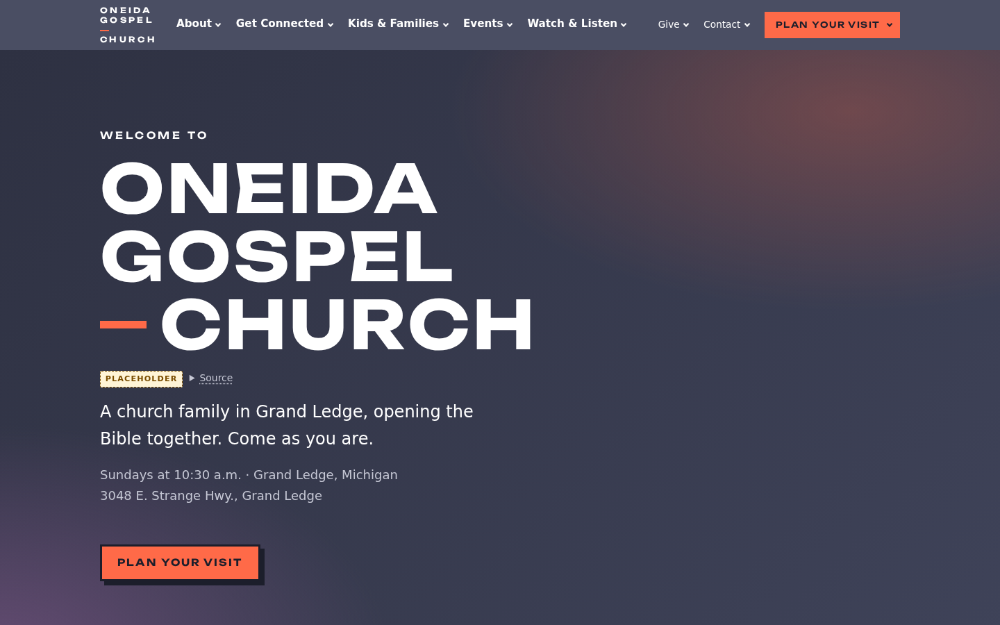
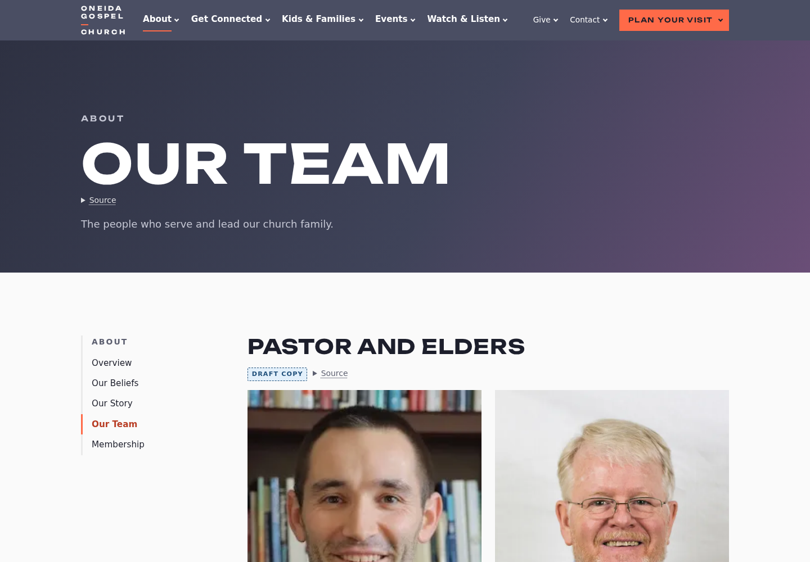
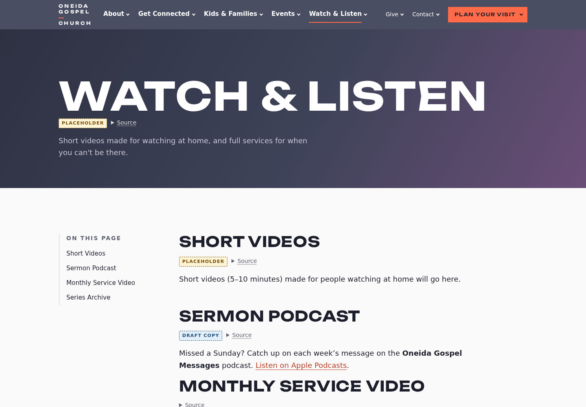
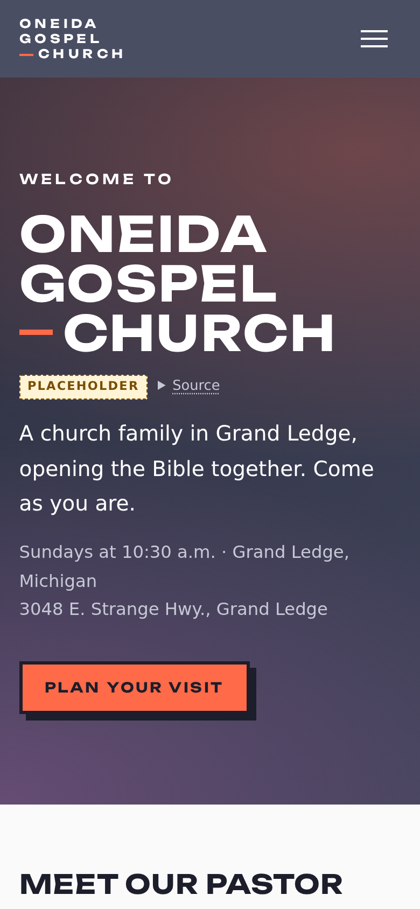

# Oneida Gospel Church website

A prototype replacement for a small church's Wix site: fast, accessible, and
cheap to run, with content volunteers can edit without touching code.

**Live demo:** https://ogc-website.netlify.app (hidden from search engines
until go-live)



| Team | Watch & Listen | Phone |
|---|---|---|
|  |  |  |

- **Astro 7**, static output, plain CSS with design tokens. No client
  framework; the only JavaScript is the mobile menu toggle.
- **Content as files:** Markdown/JSON content collections with a typed schema,
  so a bad entry fails the build and names the file. Adding a team member is
  one Markdown file. Ready for a git-based CMS later.
- **Sermons import themselves:** a GitHub Actions job reads the church's
  YouTube feed twice a day, writes new sermon files, and merges them into
  `main` through its own pull request; they go live with the next release.
- **Events stay current:** weekly events compute their next date
  (DST-safe, America/Detroit), and a daily build hook drops past events.
- **Netlify** for hosting, deploy previews on pull requests, and the contact
  form (Netlify Forms, honeypot spam filter).
- Lighthouse accessibility 100 on every page; mobile-first layout.

## About the code

Static site built with [Astro](https://astro.build). All content lives in
plain files under `src/content/` and `src/data/` — no code changes needed to
update people, sermons, events, or service times.

## Run locally

Requires Node 22.23.4+ (`nvm use` picks it up from `.nvmrc`).

```bash
npm install
npm run dev      # http://localhost:4321
npm run build    # type-check + build to dist/
npm test         # unit tests
npm run verify   # tests + type-check + build (the release gate)
```

After cloning, turn on the repo's git settings (commit email set to the
GitHub no-reply address, so personal email stays out of history, and a
`commit-msg` hook that checks Conventional Commits):

```bash
git config include.path ../.gitconfig
```

## Contributing

Every change goes through a pull request; a GitHub ruleset blocks direct
pushes, force pushes and deletion on `main` (the sermon import opens and
merges its own PRs). The repo admin can bypass the ruleset at any time; use
that only for `npm run release`.

1. Branch from an up-to-date `main`: `git switch -c feat/short-name`
   (prefix with the commit type: `feat/`, `fix/`, `content/`, `docs/`, `ci/`…).
2. Commit using [Conventional Commits](https://www.conventionalcommits.org/en/v1.0.0/):
   `type(optional scope): description`, e.g. `feat: add events page`,
   `fix(nav): close menu on tap`, `content: add fall retreat`. Allowed types
   are `TYPES` in `scripts/check-commit-msg.mjs`: the usual ones plus `content`
   (site content) and `release` (written by the release script).
   A `!` after the type, or a `BREAKING CHANGE:` footer, marks a breaking change.
3. Push and open a PR (`gh pr create`) with a Conventional Commits title.
4. Checks on the PR:
   - **Netlify deploy preview**: runs `npm run verify` (tests, type check,
     build) and posts a preview link. Check the change there.
   - **PR checks** (GitHub Actions): the PR title and every commit follow
     Conventional Commits (`scripts/check-commit-msg.mjs`).
   - **Claude code review** (not automatic): Claude reviews the PRs it opens
     and posts findings as PR comments. For a PR you opened, ask Claude for
     `/code-review <PR number> --comment`. Fix or answer each comment.
5. Merge when the checks are green, the Claude review has posted, and its
   comments are resolved. (As admin you can merge past open threads; don't.)
   Merging doesn't publish; the live site changes with the next release.

## Editing content

| What | Where |
|---|---|
| Team members | `src/content/team/*.md` (one file per person) |
| Sermons | `src/content/sermons/*.md` |
| Events | `src/content/events/*.md` |
| Service times, address, map, social links (including the sermon podcast), home page welcome line | `src/data/site.json` |
| Home page copy | `src/pages/index.astro` (its source notes: `src/content/pages/index.md`) |
| Forms (fields, button text) | `src/data/forms.ts` |
| Page copy (Plan Your Visit, About, Get Connected, Give…) | `src/content/pages/**/*.md` (`about/beliefs.md` → `/about/beliefs`) |
| The menu | `src/data/nav.ts` |
| Photos used in page copy | `src/assets/photos/` |

Each `##` heading in a page file is a section; the menu links to it by an id
made from the heading (`## New to the Area?` → `#new-to-the-area`). Renaming a
heading changes its id, so update `src/data/nav.ts` too; `npm run verify`
fails on any broken link or anchor.

For the demo, every section says whether its copy is final and where it came
from. A "Draft copy" or "Placeholder" label (none for real copy) sits under
the heading, with a "Source" toggle that opens a one-line note. Record it in
the page's frontmatter: `origin:` is the page default, and `sections:` gives
any section its own, keyed by heading id:

```yaml
origin:
  status: rewritten          # real | rewritten | placeholder
  from: https://www.oneidagospel.org/give   # a URL or a document's name
  on: 2026-11-12             # date taken (or generated); required unless real
  note: Reworded; facts unchanged.   # one short sentence
sections:
  faq:
    status: placeholder      # `from` is optional for placeholders
    from: Website Outline (Notion)
    on: 2026-11-12
    note: Questions from the outline's FAQ row; answers made up.
```

Real copy with a date reads "Verbatim from …, taken …"; real copy with no
date (site settings, the YouTube import) reads "From …". A placeholder with
no source and no note reads "made up, with no source". `/content-status`
lists every section with its label and note, plus what's still needed
(`needs:`).

To end a page with a form, name it in the frontmatter; it appears after the
copy, so it belongs to the last section. `interest` preselects the connect
form's "I'm interested in" choice:

```yaml
form:
  name: connect              # plan-visit | connect | prayer | contact
  interest: Joining a group  # optional, connect form only
```

Submissions go to Netlify (Forms in the Netlify dashboard), which shows each
form by name. Every form says it isn't monitored yet; take that line out of
`src/components/NetlifyForm.astro` once someone is reading them.

To add a photo to a page, put it in `src/assets/photos/` and use a Markdown
image with a path relative to the page file and alt text that describes it:
``. The
build resizes it and converts it to WebP. Don't use photos that show children
until the church has a written photo consent policy.

The build checks every file against the rules in `src/content.config.ts`.
If something is wrong (missing name, short bio too long, bad date), the build
stops and names the file and field.

### Add a team member

1. Create `src/content/team/first-last.md`. The filename becomes the page URL:
   `/about/team/first-last`.
2. Optional: put their photo next to it, e.g. `src/content/team/first-last.jpg`.
3. Fill in:

```markdown
---
name: First Last            # required
role: Deacon
group: deacons              # required: elders, deacons, missions, treasurer or staff
photo: ./first-last.jpg     # optional; path relative to this file
photoAlt: First Last smiling outside the church   # optional
displayOrder: 5             # lower numbers appear first; omit to sort last
shortBio: A few sentences. The team card shows the first ~150 characters. 400 max.
---

Full bio goes here, in Markdown. It appears on the person's detail page
after they click "Read More".
```

That's it — the person appears on the Our Team page under their group, in
`displayOrder` order (ties sort by name), and gets their own detail page.

To keep a URL stable when renaming the file, add `slug: first-last` to the
frontmatter.

### Add a sermon

New uploads to the church YouTube channel are imported automatically: a
GitHub Actions workflow (`.github/workflows/import-sermons.yml`) checks twice a
day (8 a.m. and 6 p.m. Eastern). When there are new sermon files, it runs
`npm run verify`, then opens a pull request with them and merges it into
`main`. They go live with the next release (see Deploy). If an import PR
ever fails to merge, later runs stop with an error until it's merged or
closed. To run it now: GitHub → Actions → Import sermons →
Run workflow.

To pull uploads by hand instead:

```bash
npm run sermons:import
```

It reads the channel's feed (latest 15 videos), takes the speaker, scripture
and sermon date from the video description's `🎙 Speaker:`, `📖 Scripture:`
and `🗓` lines, and writes one file per new video. Videos already imported are
skipped, so edits you make to those files are kept. Commit the new files on
a branch and open a PR (see Contributing).

Or add one by hand, `src/content/sermons/2026-11-01-title.md`:

```markdown
---
title: Sermon Title
date: 2026-11-01
speaker: Speaker Name
passage: Psalm 46          # optional
youtubeUrl: https://www.youtube.com/watch?v=...
series: Series Name        # optional
summary: One-line teaser.  # optional
---
```

### Add an event

`src/content/events/2026-12-24-christmas-eve.md`:

```markdown
---
title: Christmas Eve Service
start: 2026-12-24T18:00:00-05:00
end: 2026-12-24T19:00:00-05:00   # optional
location: Sanctuary              # optional
summary: Short description.      # optional
audience: Families               # optional: who it's for
kidsWelcome: true                # optional
---
```

Each event gets its own page at `/events/<file name>` (here
`/events/2026-12-24-christmas-eve`) with an "Invite a Friend" button. Every
upcoming event also gets "Add to Calendar" links: Apple / Outlook downloads
an `.ics` file (`/events/<file name>.ics`), and Google opens Google Calendar
with the event filled in. Weekly events are added as a repeating series. Past
events drop off the lists, but their pages stay up and say the event is over,
so shared links keep working.

Past events drop off automatically; the site rebuilds every morning
(`.github/workflows/daily-rebuild.yml`).

For something that meets every week, give the first meeting's date and add
`repeat: weekly`. The site always shows the next upcoming meeting. Add
`until: 2026-12-16` to stop after a date.

```markdown
---
title: Women's Bible Study
start: 2026-09-16T09:30:00-04:00   # first meeting
repeat: weekly
until: 2026-12-16                  # optional
---
```

## Deploy

The live demo is always the **newest release tag** (`vX.Y.Z`), never
`main`'s latest commit, so work in progress can sit on `main` without going
live. Each push to `main` makes Netlify run `scripts/build-release.sh`,
which builds the newest tag; until you cut a release, it rebuilds the same
version. Every pull request still gets a deploy preview of its own commit
(config in `netlify.toml`). The contact form uses Netlify Forms.

Sermons the import workflow adds to `main` go live with the next release.

### Releasing

Versions follow [Semantic Versioning 2.0.0](https://semver.org/spec/v2.0.0.html).
For this site, the "public API" is the content file format and the page URLs:

| Bump | When |
|---|---|
| MAJOR | Existing content files need edits to keep building, or a page URL is removed or renamed without a redirect |
| MINOR | A new page or feature, or a new optional content field |
| PATCH | Fixes, copy and style tweaks, new sermons or events |

Versions stay at `0.y.z` until the site goes live for real; `1.0.0` is the
public launch.

Only release a version that's done and passes everything:

1. Note changes under `## [Unreleased]` in `CHANGELOG.md` (in each PR, or
   in a `docs:` PR before releasing) and merge.
2. `git switch main && git pull`.
3. Run:

   ```bash
   npm run release -- patch   # or minor, major, or an exact version like 1.0.0
   ```

The script stops unless you're on a clean `main` that matches GitHub, runs
`npm run verify` (unit tests, type check, build), then bumps `package.json`,
turns `Unreleased` into the new version, commits `release: vX.Y.Z`, tags it,
and pushes both. Netlify publishes it. Add `--dry-run` to preview the
version and CHANGELOG without changing anything.

**Roll back:** in Netlify → Project configuration → Environment variables,
set `RELEASE_TAG` to an older tag (e.g. `v0.1.0`) and trigger a deploy.
Delete the variable to return to the newest release. (Netlify's Deploys page
can also re-publish an earlier deploy instantly.)

### Search engines

The demo is hidden from search engines (`noindex` meta tag and a
`Disallow: /` robots.txt). At go-live, set `PUBLIC_ALLOW_INDEXING=true` in the
Netlify site's environment variables and redeploy.
