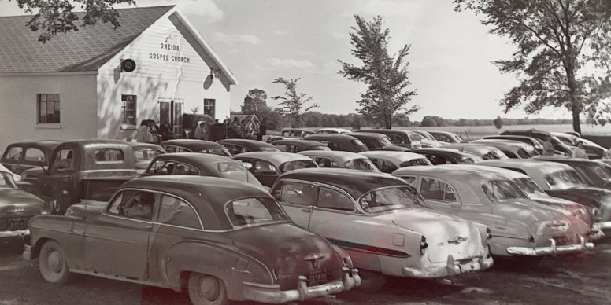
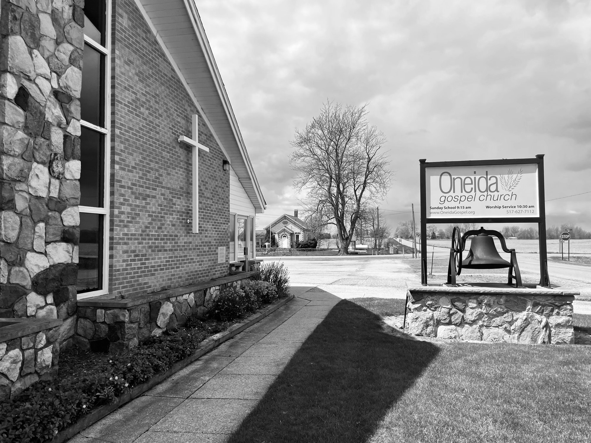

## Where We Came From

Oneida Gospel Church has been part of Grand Ledge, Michigan, since 1848. In 2023 we celebrated our 175th anniversary with a homecoming service and a picnic on the church property.

*Sunday at Oneida in the 1950s.*

Oneida began as a Presbyterian church. Today it is non-denominational, which means it isn't part of a larger church denomination. It is elder-led: a team of elders from the church oversees its teaching and care.

We're focused on the long game. Our last two pastors each served here for close to two decades, and some of our members have called Oneida home for most of their lives.

Now, with a new lead pastor, we're ready to reach out to our community and help more young families grow as followers of Jesus. We'd love to "go the long haul" with you.

## Who We Are

**Shaped by the Word of Christ.** The Bible guides everything we do and points us to Jesus. Our sermons are expository: the pastor works through a book of the Bible verse by verse, explaining what it meant and how it applies today. Our groups study the Bible together, our kids learn it in Sunday School, and our leaders rely on it to make decisions.

**A close-knit family.** People here care deeply for each other. Our elders lead by serving, and we give ourselves to help people who are hurting. We laugh, play, and linger after the service. You'll find decades-long friendships alongside brand-new ones.

## Our Mission

> To follow passionately after God, loving people as Jesus would, by the power of the Holy Spirit.

## Our Vision

> To build relationships with people in the surrounding communities and share with them the life changing truth of Jesus Christ; to encourage each other as we follow hard after God and impact our world with His love and grace, through the power of the Holy Spirit.

## What We Value

**To hunger for God: to experience God's presence.** To seek out God and His glory through His Word, through worship, prayer and through the guidance and direction of the Holy Spirit.

**To become more like Jesus: to be "Jesus with skin on."** To be in discipling relationships where we follow after the character and example of Jesus Christ and reach out to people around us with the grace, truth and love of God.

**To build His Kingdom: to be known by our love.** To be a place where we are one in worship and service; where we seek the activity of God; where the leadership humbly serves; and where we simply exist to bless, heal, draw people to Jesus and receive the blessing of God's presence.
